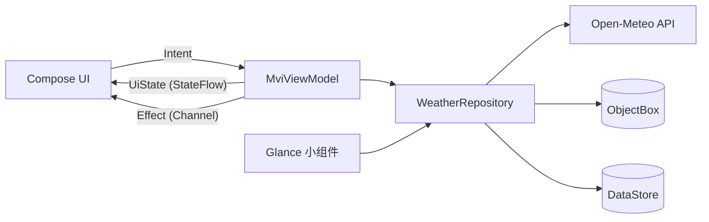

# ComposeWeather

一个用来实践现代 Android 开发（MAD）的天气应用：**Jetpack Compose + MVI 单向数据流 + Hilt + ObjectBox + DataStore + Glance 桌面小组件**。

天气数据来自 [Open-Meteo](https://open-meteo.com/)，**不需要申请 API Key**，克隆下来配好 JDK 即可直接运行。


## 功能

- **实况天气**：温度、体感、天气现象、湿度、风速、气压、紫外线
- **24 小时温度曲线**：Canvas 手绘，含渐变填充、自适应纵轴与分段标签
- **逐小时横滑** + **7 天预报**（降水概率、温度区间条、日出日落）
- **城市搜索**（输入防抖 350ms）+ 收藏管理，本地落在 ObjectBox
- **定位自动切换**：冷启动时优先取当前位置，失败降级为「当前位置」并保留上次选中城市
- **个性化设置**：温度单位（℃/℉）、主题（跟随系统/浅色/深色）、自动刷新间隔，存 DataStore
- **桌面小组件**：Glance 实现，支持横向/纵向自由调整尺寸，尺寸变小自动精简内容
- **离线可用**：天气报文缓存 30 分钟；网络异常时回退到过期缓存并在首页提示

## 技术栈

| 分层 | 选型 | 用途 |
|---|---|---|
| UI | Jetpack Compose + Material 3 | 声明式界面，无 XML 布局 |
| 架构 | MVI（StateFlow + Channel） | `Intent` 单向进入、`State` 单一数据源、`Effect` 一次性事件 |
| DI | Hilt 2.60.1 | `@HiltViewModel`、`@Binds`、`@Qualifier` 区分两套 Retrofit |
| 本地库 | ObjectBox 5.4.2 | 收藏城市、天气报文缓存、当前定位城市 |
| 偏好 | DataStore 1.3.0 | 单位、主题、刷新间隔、自动定位开关 |
| 网络 | Retrofit 3.0.0 + OkHttp 5.5.1 + kotlinx.serialization | 预报与地理编码两套接口 |
| 组件 | Glance 1.2.0 | Compose 风格的 AppWidget |
| 异步 | Coroutines 1.11.0 + Flow | 全部数据流为冷/热流，无回调嵌套 |
| 构建 | AGP 9.5.1 / Kotlin 2.4.21 / Gradle 9.6 | compileSdk 37，minSdk 30 |

## 架构



`MviViewModel<S, I, E>` 是三个页面的公共基类：

- `uiState: StateFlow<S>` 唯一数据源，`setState { copy(...) }` 归约更新；
- `dispatch(intent)` 单入口，子类只需实现 `handleIntent`；
- `effect: Flow<E>` 走 `Channel(BUFFERED)`，保证 Snackbar、导航这类事件只消费一次。

## 目录结构

```
app/src/main/java/io/gitalive/composeweather/
├── core/mvi/           MviViewModel 基类
├── data/
│   ├── local/          ObjectBox 实体与数据源、SettingsDataStore
│   ├── location/       LocationManager + Geocoder 封装
│   ├── mapper/         DTO → 领域模型
│   ├── remote/         Retrofit 接口与 DTO
│   └── repository/     仓库实现（缓存优先、失败回退）
├── domain/             模型与仓库接口（不依赖 Android）
├── di/                 Network / Database / Repository 模块、WidgetEntryPoint
├── ui/                 weather / search / settings 三页 + 公共组件
└── widget/             Glance 小组件与 Receiver
```

## 运行

环境要求：

- Android Studio（支持 AGP 9.5）
- **JDK 25**：`gradle/gradle-daemon-jvm.properties` 把 Gradle 守护进程固定到 25，缺了它会尝试从 GitHub 下载 toolchain（国内大概率失败）。可装 [Zulu 25](https://www.azul.com/downloads/) 到 `~/.jdks/`，Gradle 会自动识别
- 设备或模拟器 Android 11（API 30）及以上

```bash
./gradlew :app:assembleDebug
# 安装
adb install -r app/build/outputs/apk/debug/app-debug.apk
```

不需要配置任何 API Key；国内网络下 `settings.gradle.kts` 已把阿里云镜像前置。

## 测试

```bash
./gradlew :app:testDebugUnitTest          # JVM 单测
./gradlew :app:connectedDebugAndroidTest  # 需要连接设备
```

- **18 个 JVM 单测**：DTO 映射（缺字段、跨天截取、缓存键精度）、温度换算、ViewModel（空收藏落默认城市、定位优先、刷新失败保留数据、切换城市）
- **10 个插桩测试**：ObjectBox 内存库真实读写（去重、选中互斥、定位复用附近收藏）、Compose 界面渲染与交互（首页、错误重试、定位引导、设置页入口）

写测试时的两个坑，代码里都有注释：

1. 自动刷新是 `while (isActive) delay(...)`，测试里必须把刷新间隔设为 0，否则 `advanceUntilIdle()` 会无限推进虚拟时间；
2. `Dispatchers.Main` 用 `MainDispatcherRule` 替换为 `UnconfinedTestDispatcher`，且 `runTest` 要传入同一个 dispatcher 共享调度器。

## 实现取舍

- **用 kapt 而不是 KSP**：ObjectBox 5.4.2 稳定版只支持 kapt（KSP 支持仍在 6.0 beta），Hilt 与 ObjectBox 同时挂两套注解处理器没有收益，统一走 AGP 自带的 `com.android.legacy-kapt`。
- **关闭 configuration cache**：ObjectBox 的 `objectboxPrepareBuild` 任务持有 `Project` 引用无法序列化，与 configuration cache 不兼容。
- **不使用图片加载库**：天气图元全部用 Canvas 绘制，界面图标取自 `material-icons-core` 的矢量路径，项目里没有一张图片资源，也就没有引入 Coil 的必要。
- **定位降级链路**：网络 provider 优先 → GPS → `getLastKnownLocation` → 反查失败则显示「当前位置」。国内无 GMS，没有使用 FusedLocationProvider。
- **小组件取依赖**：`GlanceAppWidget` 不在 Hilt 的注入体系中，通过 `@EntryPoint` + `EntryPointAccessors.fromApplication` 获取仓库。

## 数据来源与许可

- 天气与地理编码数据：[Open-Meteo](https://open-meteo.com/)，遵循 **CC BY 4.0**，需署名（App 内「关于」页与首页页脚已标注）
- 本项目代码：[MIT License](LICENSE)
- 第三方组件遵循各自许可：Jetpack Compose / Hilt / Glance / Material Icons / ObjectBox 均为 Apache License 2.0
